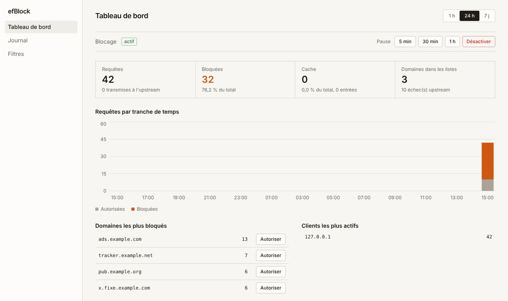
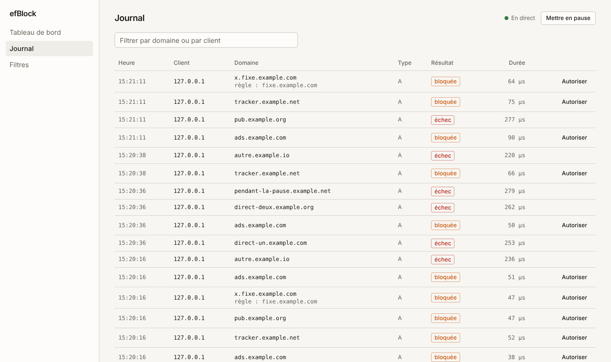

# efBlock

Un **bloqueur de publicités et de traqueurs au niveau DNS**, écrit en Go, dans l'esprit de
Pi-hole / AdGuard Home. Il tourne sur une petite VM ou un Raspberry Pi et protège tous les
appareils du réseau (PC, téléphones, invités) sans rien installer sur eux.





## Fonctionnalités

- **Serveur DNS** UDP + TCP sur le port 53.
- **Blocage par listes** : formats *hosts* (StevenBlack…), *adblock* (`||domaine^`, OISD…) et un domaine par ligne.
  Réponse `0.0.0.0` / `::` ou `NXDOMAIN`. Un domaine bloqué bloque aussi ses sous-domaines.
- **Groupes de clients** : des règles différentes selon l'appareil (aucun blocage pour un appareil, seulement certaines
  listes pour un autre, domaines autorisés ou bloqués en plus).
- **Détection du CNAME cloaking** : un traqueur caché derrière un nom innocent qui n'est qu'un alias vers lui est bloqué,
  y compris quand la réponse vient du cache.
- **Allowlist / blocklist personnelles**, prioritaires sur les listes.
- **Mise à jour automatique** des listes (24 h par défaut) ; les listes en cache sur disque permettent
  de démarrer même sans internet.
- **Upstreams chiffrés** : DNS-over-TLS (`tls://1.1.1.1`) et DNS-over-HTTPS (`https://…/dns-query`),
  avec basculement de l'un à l'autre. Un upstream en panne est mis de côté un moment (5 s, puis 10 s, 20 s…
  jusqu'à 1 minute) au lieu de faire attendre chaque requête.
- **Réseau local** : noms fixes (format `/etc/hosts`), domaines confiés à ta box, et zones inverses privées
  jamais envoyées sur internet. Le journal affiche le nom des machines.
- **Contrôle d'accès** : seuls les réseaux autorisés (par défaut, les réseaux privés) peuvent utiliser le DNS.
- **Cache** qui respecte les TTL, avec cache négatif (RFC 2308) et éviction LRU. Si tous les upstreams tombent, une
  ancienne réponse est servie en secours (RFC 8767) : un site déjà visité reste joignable. Les réponses populaires sont
  rafraîchies avant d'expirer, et les requêtes identiques simultanées sont fusionnées en une seule.
- **Journal des requêtes** (SQLite) : domaine, client, résultat, durée. Purge automatique.
- **Interface web** (Next.js, shadcn/ui) : tableau de bord avec graphique, pause du blocage (5 min / 30 min / 1 h),
  **journal des requêtes en direct**, gestion des listes et des domaines, et **page Réglages** pour
  presque toute la configuration, appliquée à chaud sans redémarrer. Protégée par mot de passe,
  réservée au réseau local.
- **Léger** : un seul binaire (interface comprise) ; environ 27 Mo de RAM avec 78 000 domaines chargés (StevenBlack), un peu plus avec des listes plus grosses.
- **Service systemd** qui redémarre tout seul, sans droits root.

## Comment une requête est traitée

```
Client ──► efBlock (UDP/TCP :53)
             │
             ├─ 1. Filtre ──── domaine bloqué ? ──► réponse 0.0.0.0 (rien ne sort du réseau)
             │      allowlist > blocklist > exceptions des listes > listes
             ├─ 2. Cache ───── déjà connu et valide ? ──► réponse immédiate
             └─ 3. Upstream ── DoT / DoH / DNS classique ──► réponse mise en cache
                    │
                    └─ Journal (SQLite, écriture asynchrone)
```

## Installation

Trois façons, de la plus simple à la plus manuelle.

### Option 1 : l'ISO (recommandée)

Une image qui installe un Debian minimal avec efBlock déjà en place, sur le modèle de pfSense ou OPNsense.

1. Télécharge `efblock-X.Y.Z-amd64.iso` dans l'onglet **Releases** du dépôt (et son `SHA256SUMS` pour vérifier le fichier).
2. Démarre la machine (ou la VM) dessus. Dans le menu de démarrage :
   - **Installer efBlock (EFFACE LE PREMIER DISQUE)** : installation automatique, sans aucune question. Elle choisit le premier
     disque interne, **jamais la clé USB** sur laquelle tu as démarré.
   - **Installation guidée** : mêmes réglages, mais tu choisis le disque.

   Rien n'est effacé tant que tu n'as pas choisi une entrée : le menu attend.
3. La machine redémarre. Un **menu s'affiche sur son écran** : il indique l'adresse de l'interface web, et te propose de régler le
   réseau (DHCP ou adresse fixe) et de **choisir le mot de passe** (option 2). C'est tout.

L'installation **télécharge les paquets Debian** : la machine doit avoir internet pendant l'installation (DHCP). Il n'y a aucun
mot de passe par défaut : tu le choisis au premier démarrage.

### Option 2 : le paquet Debian

Sur un Debian 13 existant (ou Ubuntu récent), en root :

```bash
apt install ./efblock_X.Y.Z_amd64.deb      # amd64 ; il existe aussi une version arm64
```

Le paquet crée le compte `efblock`, installe le service et le démarre. Définis ensuite le mot de passe de l'interface web :

```bash
efblock-console          # menu complet, option 2
```

### Option 3 : depuis les sources

Voir « Installation depuis les sources » plus bas.

## Console d'administration

`efblock-console` est un menu en texte, **qui évite d'ouvrir des fichiers dans `/etc`**. Sur une installation par ISO, il
s'affiche tout seul sur l'écran de la machine ; ailleurs, lance-le en root.

```
  1) Réseau (DHCP ou adresse fixe)
  2) Mot de passe de l'interface web
  3) Adresses d'écoute et HTTPS
  4) Redémarrer le service efBlock
  5) Voir les journaux
  6) Mettre à jour efBlock
  7) Shell (administrateur)
  8) Redémarrer la machine
  9) Éteindre la machine
```

- **Réseau** : choisis la carte, puis DHCP ou une adresse fixe. Les valeurs sont vérifiées avant d'être appliquées (une passerelle
  hors du réseau est refusée, par exemple).
- **Adresses d'écoute et HTTPS** : change les ports, et active HTTPS avec un certificat auto-signé généré pour toi. Ces réglages
  ne sont volontairement pas dans l'interface web : une erreur d'adresse te couperait l'accès à cette interface.
- **Shell** : le compte administrateur n'a pas de mot de passe au départ ; il te demande d'en choisir un à la première utilisation.

Pour tout le reste (upstreams, listes, groupes, cache, accès), utilise l'**interface web**.

## Mettre à jour

Depuis le menu de la console, **option 6**, ou en une commande :

```bash
efblock-console -update
```

Il lit la dernière version publiée sur GitHub, télécharge le paquet, **vérifie son empreinte SHA-256** et l'installe. Ta configuration,
ton mot de passe et tes réglages sont conservés. L'empreinte protège d'un fichier corrompu ou tronqué ; elle ne protège pas d'un compte
GitHub piraté, comme pour n'importe quel logiciel : fais confiance à la source.

## Installation depuis les sources

Testé sur Debian 13. Les commandes s'exécutent en **root** (`su -`) ; `sudo` n'est pas nécessaire.

### 1. Prérequis

```bash
apt update && apt install -y git curl make
```

Go 1.25 ou plus récent (le paquet `golang` de Debian est trop ancien) :

```bash
curl -LO https://go.dev/dl/go1.25.0.linux-amd64.tar.gz
rm -rf /usr/local/go && tar -C /usr/local -xzf go1.25.0.linux-amd64.tar.gz
echo 'export PATH=$PATH:/usr/local/go/bin' >> ~/.profile && source ~/.profile
go version
```

(Sur une machine ARM, remplace `amd64` par `arm64`.)

### 2. Récupérer et compiler

```bash
git clone https://github.com/x3Lo/efBlock.git
cd efBlock
make build
```

Pour mettre à jour une installation faite depuis les sources : `cd ~/efBlock && git pull && make install`.

Node.js n'est **pas** nécessaire : l'interface est déjà compilée et embarquée dans le binaire.

### 3. Configurer

```bash
cp deploy/config.example.yaml config.yaml
./efblock -hash-password        # demande un mot de passe, affiche son hash
nano config.yaml
```

Au minimum, règle :

```yaml
dns:
  listen: "192.168.1.10:53"      # l'IP FIXE de ta VM, port 53
web:
  listen: "192.168.1.10:8080"
  password_hash: '$2a$10$...'    # le hash affiché, entre guillemets simples
```

### 4. Essayer à la main

```bash
./efblock -debug
```

Dans un autre terminal (ou depuis un autre appareil) :

```bash
dig @192.168.1.10 example.com           # doit répondre avec une vraie IP
dig @192.168.1.10 ad.doubleclick.net    # doit répondre 0.0.0.0
```

Ouvre ensuite `http://192.168.1.10:8080`. Arrête avec `Ctrl+C`.

### 5. Installer comme service

(Si tu as installé par ISO ou par paquet, ignore cette section : le service est déjà en place.)

```bash
make install
```

Le script crée l'utilisateur `efblock`, copie le binaire dans `/usr/local/bin`, ta config dans
`/etc/efblock/config.yaml`, installe le service et le démarre. Il est relançable sans risque.

```bash
systemctl status efblock          # doit afficher "active (running)"
journalctl -u efblock -f          # logs en direct
```

Le service redémarre tout seul en cas de plantage et au démarrage de la machine. Les données
(listes, journal, état) sont dans `/var/lib/efblock/data`.

### 6. Utiliser efBlock sur tout le réseau

1. Donne une **IP fixe** à la VM (ou une réservation DHCP sur ton routeur).
2. Dans la configuration **DHCP** de ton routeur/box, mets l'IP d'efBlock comme **serveur DNS**.
   Les appareils la reçoivent en se (re)connectant.
3. Garde un DNS de secours (ex. `1.1.1.1`) en 2ᵉ position tant que tu n'as pas confiance : si efBlock
   tombe, tu gardes internet (mais sans blocage pour les appareils qui basculent dessus).
4. **IPv6** : si ton routeur annonce son propre DNS en IPv6, certains appareils le préféreront à efBlock.
   Désactive-le ou annonce l'adresse IPv6 d'efBlock.

> Certaines box (Livebox, Freebox…) ne permettent pas de changer le DNS distribué. Dans ce cas, désactive
> leur serveur DHCP et utilise-en un autre (routeur secondaire, pfSense/OPNsense…), ou règle le DNS appareil par appareil.

## Interface web

- Adresse : `http://IP_DE_LA_VM:8080`.
- Le mot de passe n'est jamais stocké en clair, seulement son hash bcrypt.
- Seuls les réseaux de `web.allowed_cidrs` y accèdent (par défaut : les réseaux privés, jamais internet).
  Après 5 mots de passe faux, l'IP est bloquée 5 minutes.

**Attention : en HTTP, le mot de passe circule en clair sur le réseau.** Si d'autres personnes utilisent
ton wifi, fais au moins l'un des deux :

```yaml
web:
  allowed_cidrs: ["192.168.1.50/32"]   # seulement TON poste
```

ou active HTTPS avec un certificat auto-signé :

```bash
openssl req -x509 -newkey rsa:2048 -nodes -days 825 -subj "/CN=efblock" \
  -addext "subjectAltName=IP:192.168.1.10" \
  -keyout /etc/efblock/key.pem -out /etc/efblock/cert.pem
chown root:efblock /etc/efblock/key.pem /etc/efblock/cert.pem && chmod 640 /etc/efblock/key.pem
```

```yaml
web:
  tls_cert: "/etc/efblock/cert.pem"
  tls_key: "/etc/efblock/key.pem"
```

(Ton navigateur affichera un avertissement la première fois : le certificat est le tien, pas celui d'une autorité.)

## Configuration

La base est un fichier YAML ; voir [`deploy/config.example.yaml`](deploy/config.example.yaml), commenté.

Presque tout peut aussi se régler depuis la page **Réglages** de l'interface, **sans redémarrer** :
résolveurs amont (avec un bouton « Tester »), réseau local, mode de blocage, cache, journal, accès
et mot de passe. Les valeurs enregistrées dans l'interface vont dans `data/settings.json` et remplacent
celles de `config.yaml` pour le groupe modifié ; « Rétablir config.yaml » revient en arrière. Une valeur
invalide est refusée avant d'être appliquée, et l'interface refuse un réseau qui t'exclurait toi-même.

Restent dans `config.yaml` : les adresses d'écoute (`dns.listen`, `web.listen`), HTTPS, le dossier de données
et le hash initial du mot de passe. Une faute de frappe sur une adresse d'écoute te couperait l'accès à
l'interface ; il vaut mieux pouvoir la réparer depuis un terminal.

| Section | Option | Défaut | Rôle |
|---|---|---|---|
| `dns` | `listen` | `:53` | adresse d'écoute (UDP + TCP) |
| | `upstreams` | *(obligatoire)* | `tls://IP`, `https://hôte/chemin` ou `IP[:port]` ; essayés dans l'ordre |
| | `bootstrap` | `1.1.1.1:53`, `9.9.9.9:53` | DNS classiques, seulement pour trouver l'IP d'un upstream donné par son nom |
| | `timeout` | `3s` | délai max par upstream |
| | `allowed_clients` | réseaux privés | qui peut utiliser le DNS ; les autres reçoivent `REFUSED` |
| | `local.upstream` / `local.domains` | *(aucun)* | résolveur du LAN (ta box) et suffixes qui lui sont confiés |
| | `local.hosts` | *(aucun)* | noms fixes, format `/etc/hosts` : `192.168.1.20 nas.maison nas` |
| `filter` | `lists` | *(aucune)* | listes de filtres (URL ou fichier local) |
| | `allowlist` / `blocklist` | vides | domaines fixes (sous-domaines inclus) |
| | `block_mode` | `zero_ip` | `zero_ip` (0.0.0.0 / ::) ou `nxdomain` |
| | `update_interval` | `24h` | fréquence de mise à jour des listes |
| | `data_dir` | `./data` | cache des listes, état, journal |
| | `cname_check` | `true` | bloque aussi les réponses dont un alias (CNAME) mène à un domaine bloqué |
| `cache` | `enabled` / `max_entries` / `max_ttl` | `true` / `10000` / `24h` | cache DNS |
| | `serve_stale` / `stale_max` | `true` / `24h` | sert une ancienne réponse si aucun upstream ne répond, jusqu'à cet âge |
| | `prefetch` | `true` | rafraîchit en avance les réponses populaires |
| `querylog` | `enabled` / `retention_days` | `true` / `7` | journal (`-1` = illimité) |
| `web` | `listen` / `password_hash` | `:8080` / *(vide = désactivée)* | interface d'administration |
| | `allowed_cidrs` | réseaux privés | qui peut s'y connecter |
| | `tls_cert` / `tls_key` | *(vides)* | active HTTPS |

Les domaines ajoutés **depuis l'interface** sont sauvegardés à part (`state.json`) et s'additionnent à ceux du fichier ;
l'interface ne peut pas supprimer ceux de `config.yaml`.

### Groupes de clients

La page **Groupes** applique des règles différentes selon l'appareil. Un groupe contient des adresses (`192.168.1.50`)
ou des réseaux (`192.168.1.0/24`) et choisit :
- **Aucun blocage** pour ses appareils, ou
- **Un filtrage personnalisé** : toutes les listes, ou seulement certaines, plus des domaines autorisés ou bloqués propres au groupe.

Ordre de priorité pour un appareil d'un groupe : allowlist du groupe, blocklist du groupe, allowlist globale, blocklist
globale, exceptions des listes, listes de filtres (celles du groupe). Si un appareil figure dans plusieurs groupes, **le premier
de la liste** s'applique. Les groupes sont enregistrés dans `data/state.json`.

Un appareil est reconnu par son **adresse IP** : réserve-lui une adresse fixe dans le DHCP de ta box ou de pfSense.

Après une modification de `/etc/efblock/config.yaml` : `systemctl restart efblock`.

## Dépannage

**`address already in use` sur le port 53** — un autre programme écoute déjà (souvent `systemd-resolved`
sur Ubuntu). Identifie-le avec `ss -lunp | grep ':53 '`. Pour libérer le port :

```bash
systemctl disable --now systemd-resolved
rm /etc/resolv.conf && echo "nameserver 1.1.1.1" > /etc/resolv.conf
```

**`tls://… i/o timeout` dans les logs** — le port 853 (DoT) est bloqué par ton réseau (fréquent dans les
écoles et entreprises). Utilise un upstream DoH, qui passe par le port 443 :

```yaml
upstreams:
  - "https://cloudflare-dns.com/dns-query"
  - "https://dns.quad9.net/dns-query"
```

**Un site ne marche plus** — ouvre le *Journal* de l'interface, cherche le domaine bloqué et clique sur
« Autoriser », ou mets le blocage en pause 5 minutes depuis le tableau de bord.

**Windows affiche « pas d'accès à internet »** alors que ça marche — vérifie que efBlock écoute bien sur le
port **53** (et non 5353) ; Windows teste sa connexion via le DNS.

**Les logs** : `journalctl -u efblock -n 50 --no-pager`. Pour le détail de chaque requête, lance
`/usr/local/bin/efblock -debug -config /etc/efblock/config.yaml` à la main (service arrêté).

## Sécurité

- **Le DNS n'est servi qu'aux réseaux de `dns.allowed_clients`** (par défaut les réseaux privés). Un serveur DNS
  ouvert à tous peut être détourné pour attaquer des tiers. N'expose jamais le port 53 sur internet.
- **Listes de filtres vérifiées** : une liste qui ne contient aucun domaine reconnaissable (page d'erreur
  servie avec le code 200) ou qui perd plus de 70 % de ses domaines d'un coup est rejetée, l'ancienne copie reste en place.
- **Le service tourne sans droits** : utilisateur dédié, système de fichiers en lecture seule,
  seule capacité accordée : ouvrir le port 53.
- Journal des requêtes : il contient les domaines visités par chaque appareil. Réduis `retention_days`
  ou désactive-le (`querylog.enabled: false`) si cela te gêne.

## Limites

- Le blocage DNS arrête les pubs servies par des domaines **tiers**. Il ne peut pas bloquer celles qui
  viennent du même domaine que le contenu (ex. YouTube), ni masquer les cadres vides qu'elles laissent.
- Un appareil qui utilise son propre DNS chiffré (DoH intégré au navigateur, *iCloud Private Relay*)
  contourne efBlock.
- Pas de validation DNSSEC (le bit DO est transmis à l'upstream, la validation est laissée au client).
- Les groupes reconnaissent un appareil par son adresse IP, pas par son adresse MAC : une adresse qui change fait sortir
  l'appareil de son groupe.
- La vérification des alias porte sur les CNAME d'une même réponse : un traqueur qui répondrait directement avec une
  adresse IP, sans alias, ne peut être arrêté que par son nom.

## Développement

```bash
make test        # go test -race ./...
make build       # compile le binaire
make ui          # recompile l'interface Next.js (nécessite Node 22) et l'embarque
make deb         # construit le paquet Debian dans dist/
make iso         # construit l'ISO d'installation dans dist/ (xorriso requis)
```

```
cmd/efblock/          point d'entrée : lit la config, assemble les composants
internal/config/      chargement et validation du YAML
internal/dnsserver/   serveur UDP/TCP : filtre → cache → upstream, journal
internal/filter/      parsing des listes (hosts, adblock), matching des domaines, groupes de clients, alias, mise à jour
internal/cache/       cache TTL + LRU + cache négatif, réponses périmées, préchargement
internal/upstream/    clients DNS classique, DoT, DoH, état de santé des upstreams
internal/localdns/    noms fixes, domaines locaux, zones inverses privées, noms des clients
internal/settings/    réglages modifiables depuis l'interface (settings.json), appliqués à chaud
internal/querylog/    journal SQLite et statistiques
internal/store/       réglages modifiables depuis l'interface (state.json)
internal/web/         API JSON sécurisée + interface embarquée (dist/)
web-ui/               source de l'interface (Next.js, Tailwind, composants shadcn/ui, Recharts ; export statique)
cmd/efblock-console/  menu d'administration de la machine (réseau, mot de passe, HTTPS, mise à jour)
packaging/            construction du paquet Debian (.deb)
image/                construction de l'ISO d'installation (fichier de réponses, menus de démarrage)
deploy/               service systemd, script d'installation depuis les sources, config d'exemple
```

`internal/web/dist/` contient l'interface **compilée**, versionnée pour que `go build` fonctionne sans Node.
Après une modification de `web-ui/`, relance `make ui` et commite le résultat.

### Publier une version

```bash
git tag v1.0.0 && git push origin v1.0.0
```

Le workflow `.github/workflows/release.yml` teste, construit les paquets (amd64 et arm64) et l'ISO, puis les publie dans *Releases* avec
leur `SHA256SUMS`. C'est ce fichier que `efblock-console -update` utilise pour vérifier une mise à jour.

L'ISO se construit à partir de l'ISO « netinst » officielle de Debian, vérifiée par son empreinte (`image/build.sh`).
